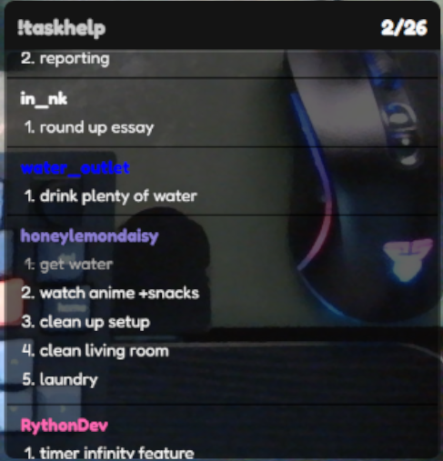
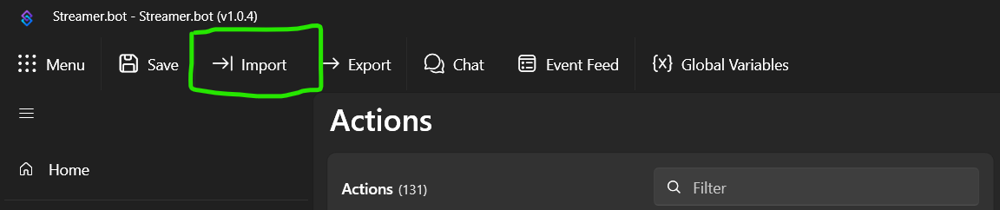
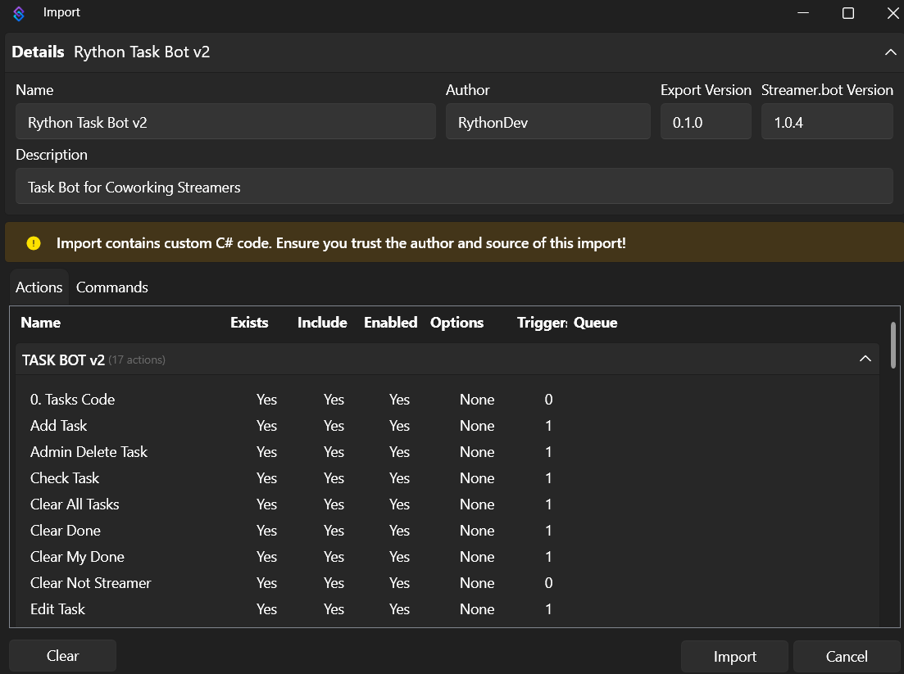
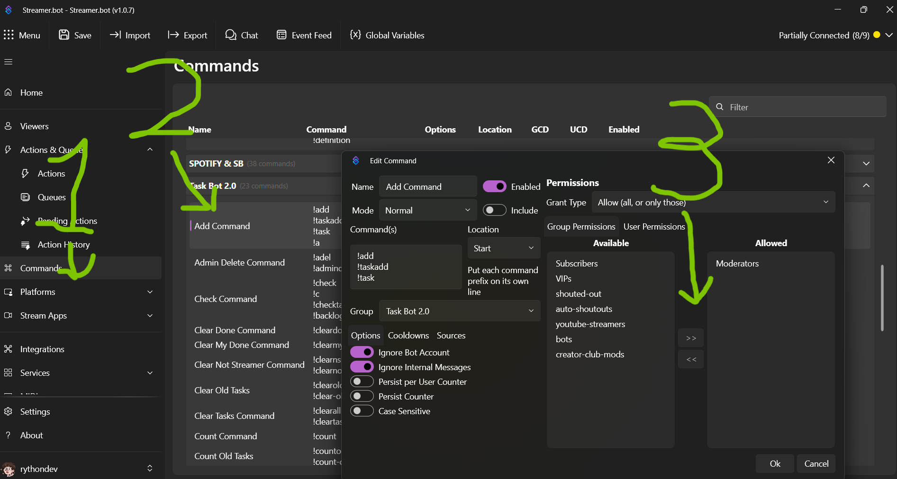

# Rython Task Bot v2

Task Bot for Co-working streamers on Twitch & YouTube.

## Why this Task Bot?

- Browser Source is optional
  - You only need Streamer.Bot running to have it working with chat
- Compatible with Twitch, YouTube and Kick; possibly extending to Trovo
- Task data is accessible via Streamer.Bot global variable
- Commands' permissions are easily configurable:
  - Mod (and Streamer) only
  - VIP and above
  - Subscribers and above
  - etc.
- Easy customizable with other Streamer.Bot actions

## Widget

Widget can be found in the [widget folder](/widget). 

## Setup Instructions

1. Install and setup [Streamer.Bot](https://streamer.bot/)
   - [Nutty's StreamerBot Setup Video](https://youtu.be/gfGy1gRH5ik?t=146) 
   - [RythonDev's TaskBot Setup video](https://youtu.be/oaCBTBqHu7Q)

2. Open Streamer.Bot and click on Import

   > 

3. Import the string from [RythonTaskBot.sb](./RythonTaskBot.sb)

    - Copy paste the string into the `Import` box

        OR

    - Drag the file into the `Import` box

    > 

4. Click on the `Import` button

5. You may need to go to the Commands tab and enable the commands.

## Usage

### Commands

-   `!add [task]` : add the task to your list
-   `!focus (number / task)` : focus on ONE task
-   `!edit (number) [task]` : edit the task at the specified index
-   `!done (number / task)` : mark task as done
-   `!undone (number / task)` : mark task as incomplete
-   `!remove (number / task)` : remove task from list
-   `!unfocus` : unfocuses on your focused task
-   `!clearmydone` : Clears all your completed tasks

### Moderators only

-   `!clearall` - Clear all tasks
-   `!cleardone` - Clear all completed tasks
-   `!clearold [days]` - Clear tasks that are at least `[days]` days old (e.g. `!clearold 7`)
-   `!countold [days]` - Count tasks that are at least `[days]` days old (e.g. `!countold 7`)
-   `!adel @user` - Remove all tasks from a user

### Language

Customize language [here](./languages.md)

You can also customise the commands yourself on StreamerBot.

### Commands Config

Configure your commands! Command permissions, command aliases etc.

1. Click on Commands tab on StreamerBot
2. Double click on a command you want to edit
3. Configure the permission level, commands aliases, commands sources etc. 

## Support

Get support on Discord: https://discord.gg/FuN48jdrv7

## Credits

- [RythonDev](https://twitch.tv/RythonDev)
